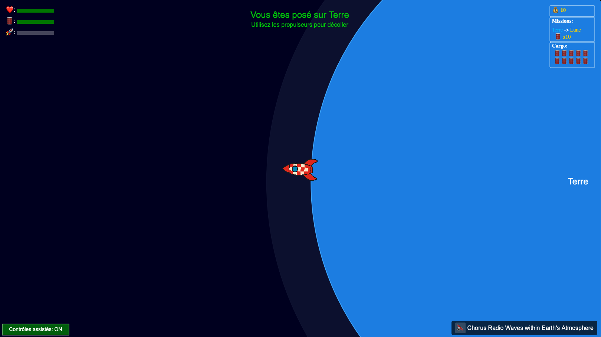
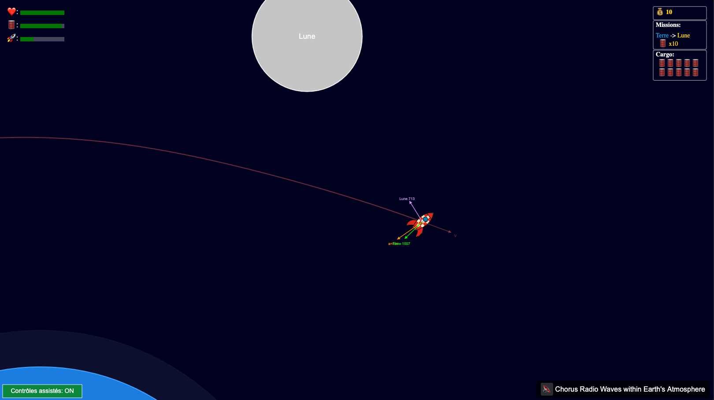
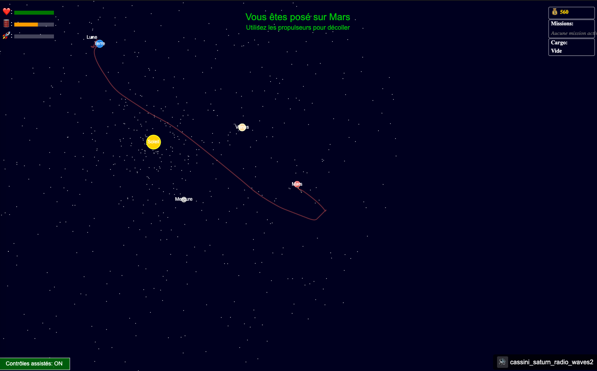
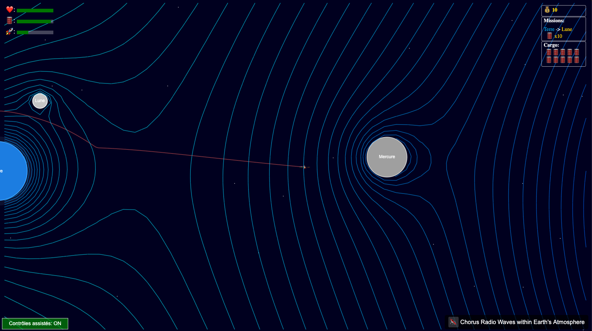

# Pocket Cosmos : Simulation de Fusée 🚀

Une simulation interactive et physique d'une fusée utilisant Matter.js, avec des missions, de la gestion de cargo et une IA optionnelle. 🌌

## 🚀 Présentation

Prenez les commandes ! Ce projet vous permet de piloter une fusée dans un mini-système solaire, d'accomplir des missions, de gérer votre cargaison, et de maîtriser les subtilités de la gravité et des atterrissages (plus ou moins) réussis. 🌍🌕🛰️

- [Lancer la Simulation](https://habib256.github.io/pocketcosmos/index.html)
  _(Cliquez pour essayer !)_ ✨
- [Interface d'Entraînement IA](https://habib256.github.io/pocketcosmos/training-interface.html)
  _(Entraîner l'IA à piloter de A vers B !)_ 🤖

### Captures d'écran 📸


*Écran de démarrage avec sélection du monde à gauche et bouton "Prêt !" à droite*


*La fusée près de la lune en orbite avec affichage des vecteurs de la fusée*


*Suivi de la trajectoire*


*Tracée des équipotentielles*

## ✨ Fonctionnalités Principales

### Simulation & Physique
*   **Physique Réaliste (Matter.js):** Simulation basée sur Matter.js 0.19.0 avec gestion de la gravité via le plugin matter-attractors.
*   **Mécaniques d'Atterrissage/Crash 😬💥:** Maîtrisez les atterrissages en douceur ou subissez les conséquences d'un crash.
*   **Champ de Gravité et Lignes Équipotentielles 🌀:** Visualisez le champ de gravité sous forme de flèches ou de lignes équipotentielles (isopotentielles).

### Gameplay
*   **Système de Missions 🏆:** Acceptez et accomplissez des missions de transport entre corps célestes.
*   **Gestion de Cargo 📦:** Collectez, transportez et livrez différentes cargaisons (carburant, outils, etc.).
*   **Système de Crédits 💰:** Gagnez des crédits en réussissant des missions.
*   **6 Mondes Disponibles 🌍:** Système solaire, Kerbol, Outer Wilds, Tatoo, Endor, et un monde alien.
*   **Stations Spatiales 🛰️:** Amarrez-vous aux stations pour vous ravitailler.

### Contrôles & Interface
*   **Pilotage Intuitif 👍:** Contrôlez précisément votre fusée avec plusieurs propulseurs.
*   **Caméra Dynamique 🎥:** Suivi de la fusée et zoom ajustable.
*   **Interface Utilisateur Complète 📊:** Suivez vitesse, altitude, fuel, santé, mission active, cargo, crédits.
*   **Trajectoire Visible 📈:** Activez la trace pour visualiser votre parcours.
*   **Aide au Pilotage 🤓:** Contrôles assistés pour une meilleure stabilisation.

### Visuels & Audio
*   **Effets Visuels ✨:** Particules pour les propulseurs, débris de crash, étoiles scintillantes.
*   **Ombres/Pénombres Planétaires:** Ombrage jour→nuit orienté par l'étoile centrale, atmosphères ombrées.
*   **Anneaux Planétaires:** Rendus en deux passes (back/front) pour un effet réaliste.
*   **Ambiance Sonore Riche 🔊:** Musique d'ambiance spatiale variée, sons pour les propulseurs, collisions et crashs.

### Intelligence Artificielle
*   **IA Optionnelle (TensorFlow.js) 🤖:** Agent Deep Q-Network pour piloter automatiquement la fusée.
*   **Interface d'Entraînement Complète:** Application web dédiée (`training-interface.html`) avec graphiques temps réel, métriques et visualisation.

### Architecture
*   **Architecture Modulaire (MVC + EventBus) 🏗️:** Code structuré et découplé facilitant la maintenance et l'évolution.
*   **Mondes préconfigurés:** 6 univers chargés depuis `assets/worlds/*.json`. (Une source
    `random` existe dans le code de chargement mais le générateur `window.ProceduralGenerator`
    n'est pas implémenté : la génération procédurale de mondes n'est pas disponible aujourd'hui.
    Les ceintures d'astéroïdes, elles, sont bien générées procéduralement.)

## 🎮 Contrôles

- **↑ ou W** : Propulsion avant (principale)
- **↓ ou S** : Propulsion arrière (rétro)
- **← (Flèche Gauche)** : Rotation vers la **droite**
- **→ (Flèche Droite)** : Rotation vers la **gauche**
- **A** : Rotation vers la **gauche** (propulseur latéral)
- **D** : Rotation vers la **droite** (propulseur latéral)
- **Barre Espace** : Propulsion avant (Boost)
- **R** : Réinitialiser la fusée 🔄
- **C** : Centrer la caméra sur la fusée 🎯
- **+ / -** (ou Molette Souris) : Zoom avant / arrière 🔍
- **T** : Afficher/masquer la trace de trajectoire
- **V** : Afficher/masquer les forces sur la fusée (attraction des astres, poussée) et la vitesse, avec une légende
- **G** : Afficher/masquer le champ de gravité (flèches puis lignes équipotentielles)
- **I** : Activer/désactiver le contrôle par l'IA 🤖
- **P** ou **Echap** : Pause / Reprendre la simulation
- **M** : Diminuer la puissance globale des propulseurs
- **N** : Augmenter la puissance globale des propulseurs
- **H** : Activer/désactiver l'aide au pilotage 🤓 (stabilisation automatique de la rotation)

Également disponibles (non listés ci-dessus car non clavier) : **glisser-déposer à la souris**
pour déplacer la caméra, et une **manette** (sticks : rotation/zoom · A : poussée · Y : rétro ·
LB/RB : traces/vecteurs · Start : pause · L3 : réinitialiser · View : centrer la caméra).

### 📱 Contrôles tactiles (tablette, téléphone)

Sur un appareil tactile, des boutons semi-transparents apparaissent automatiquement une fois le
monde lancé (détection `(pointer: coarse)`, ou dès le premier appui au doigt sur un ordinateur
à écran tactile). Ils restent masqués sur un ordinateur à souris. Le bouton **✋**, à côté de ⚙️
en bas à droite, les affiche ou les masque à tout moment (ce choix l'emporte ensuite sur la
détection automatique).

| Où | Bouton | Effet |
|---|---|---|
| Pouce gauche | **↺** / **↻** (maintenir) | Tourner à gauche / à droite — comme **←** / **→** |
| Pouce droit | **▲ Poussée** (maintenir) | Propulsion principale — comme **↑** / **W** |
| Pouce droit | **▼ Rétro** (maintenir) | Propulsion arrière — comme **↓** / **S** |
| En bas au centre | **T**, **G**, **V**, **C** | Trajectoire, champ de gravité, vecteurs, centrer la caméra |
| En bas au centre | **−** / **+** | Zoom (maintenir pour répéter) |
| En bas au centre | **Ⅱ Pause**, **R Recommencer** | Pause / reprise, replacer la fusée |

- **Plusieurs doigts à la fois** : on peut pousser et tourner en même temps.
- Les commandes maintenues s'arrêtent dès que le doigt se lève, et aussi si le navigateur annule
  le toucher, si la page perd le focus ou si l'onglet est masqué.
- Un bouton ponctuel (T, G, V, C, Pause, R) agit quand le doigt se lève **sur** le bouton :
  glisser le doigt hors du bouton annule.
- **Sur la zone de jeu** : un doigt fait glisser la vue (C recentre sur la fusée), **deux doigts
  pincent pour zoomer** — même avec un pouce posé sur ▲.
- La page ne défile pas et ne zoome pas sous les doigts (`touch-action: none`), pas de menu ni de
  sélection de texte sur appui long. L'affichage suit la taille de la fenêtre ou du cadre
  (`iframe`) et la rotation de la tablette.

Les boutons passent par le même chemin que le clavier (`InputController.appuyerCommande` /
`relacherCommande` / `executerActionPonctuelle`) : aucune règle de pilotage n'est dupliquée.
Code : `controllers/TouchControlsController.js` (boutons) et `InputController.initTouchEvents`
(glisser, pincer).


## 🎓 Mode Découverte : la gravitation au collège (Monde 1)

Pensé pour le chapitre de 3e « La gravitation universelle » (programme de cycle 4) : un panneau
**🎯 Défis**, à gauche sous les jauges, propose quatre défis courts. Chacun est validé
**automatiquement** d'après l'état réel de la simulation, puis une explication relie ce que l'élève
vient de voir au cours.

| Défi | Ce que fait l'élève | Validé quand… | Notion du cours |
|---|---|---|---|
| 1. Décoller… et retomber | décolle puis coupe les moteurs | moteurs coupés, la fusée redescend | interaction gravitationnelle à distance ; le poids, P = m × g |
| 2. Plus loin, moins attirée | monte à 2 fois la distance au sol (centre de la Terre) | d ≥ 2 × d(sol) | F = G × (m₁ × m₂) / d² : distance × 2 → force ÷ 4 |
| 3. Tomber autour de la Terre | accélère parallèlement au sol puis coupe les moteurs | un quart de tour de la Terre sans moteur ni contact, la Terre retenant la fusée (énergie < 0) | l'orbite : une chute qui « rate » la Terre (Newton) |
| 4. Sur la Lune, moins attirée | s'approche tout près de la Lune ou s'y pose | la Lune devient l'astre qui attire le plus | le poids dépend de l'astre, pas la masse |

- Pendant le défi 2, le panneau affiche en direct « Distance au centre de la Terre : 1,6 fois celle
  du décollage. Attraction de la Terre : 2,5 fois plus faible qu'au décollage. » : **uniquement des
  rapports**.
  Les unités du jeu ne sont pas celles du Système international (système solaire miniature) ; aucune
  valeur en mètres, km/h ou newtons n'est affichée.
- Le panneau se replie (bouton 🎯, légende comprise), ◀ ▶ changent de défi ; boutons de 44 px au
  moins, utilisables au doigt, à la souris et au clavier (Tab). Replié d'office sur un petit écran
  (téléphone) ; plus étroit sur écran moyen pour laisser libre le centre, où l'on pince et glisse. Quand il est déplié,
  la caméra centre la fusée dans la zone restée libre (entre le panneau et les boutons ▲ ▼).
- **Touche V** (bouton « Forces ») : flèches nommées « Attraction de la Terre », « Attraction de la
  Lune »… (dirigées vers le centre de l'astre) et « Poussée », partant du centre de la fusée et
  dessinées **à la même échelle** : au sol de la Terre, l'attraction mesure 120 px ; à 2 fois la
  distance, 30 px (4 fois moins). Une attraction n'est dessinée que si elle vaut au moins 20 % de la
  plus forte. « Vitesse » (pointillés, longueur fixe) et la direction de la mission complètent. Une
  légende s'affiche sous le panneau, ainsi qu'une légende du champ de gravitation (touche **G**).
- Rien n'est enregistré ni transmis ; la progression repart de zéro à chaque chargement.
- Le guide ne s'affiche pas dans les mondes 2 à 6 (ils n'ont ni Terre ni Lune) ; les flèches V y
  fonctionnent (échelle : poids sur l'astre de départ).

**Ce que la simulation fait réellement** (mesuré au banc Chrome + vrai Matter.js, voir CHANGELOG) :
- la gravité appliquée à la fusée suit exactement F = G × M × m / d² (d entre les centres) :
  rapports mesurés 2,252 / 4,005 / 9,014 / 16,024 à 1,5 / 2 / 3 / 4 fois la distance au sol, pour
  2,25 / 4 / 9 / 16 attendus ;
- **écart avec la réalité** : les astres du Monde 1 sont immobiles alors que le Soleil attire aussi
  la fusée (≈ 5,5 % de son poids au sol). Une orbite complète moteurs coupés autour de la Terre est
  donc pratiquement impossible : sur 354 lancements idéaux simulés (vitesse orbitale, 5 altitudes,
  8 positions, 2 sens), le meilleur fait 1,04 tour, 29 % dépassent un demi-tour, 82 % un quart de
  tour. C'est pourquoi le défi 3 demande un quart de tour, et son explication le dit à l'élève ;
- dans le jeu, le poids de la fusée sur la Lune vaut 64 % de son poids sur Terre (16 % en réalité) :
  l'explication du défi 4 donne les deux valeurs.

Code : `controllers/GuideDecouverteController.js` (panneau, défis, légende),
`VectorsView.renderForcesPedagogiques` (flèches), `PhysicsVectors.calculerAttractions`.

## 🔧 Technologies

- **Matter.js** (`0.19.0`) + **Matter-Attractors** (`0.1.6`) - Moteur physique et gravité
- **TensorFlow.js** (`4.13.0`) - Intelligence artificielle (Deep Q-Network)
- **HTML5 Canvas** - Rendu graphique
- **JavaScript** (ES6+) - Logique applicative

## 🏗️ Architecture

Le projet suit une architecture **MVC étendue avec EventBus** pour une communication découplée :

```
├── models/         # État des données (RocketModel, UniverseModel, etc.)
├── views/          # Rendu visuel (RocketView, UniverseView, UIView, etc.)
├── controllers/    # Logique métier (GameController, PhysicsController, etc.)
├── assets/worlds/  # Presets de mondes JSON
├── constants.js    # Constantes globales
└── EventTypes.js   # Définitions des événements
```

**Fichiers clés :**
- `GameController.js` - Chef d'orchestre, boucle de jeu principale
- `RocketModel.js` - État complet de la fusée
- `RenderingController.js` - Coordination du rendu

> 📖 **Pour les développeurs :** Consultez `CLAUDE.md` pour la documentation technique complète de l'architecture.

**Nouveauté pédagogique :**
- L'affichage du champ de gravité (touche G) permet d'explorer visuellement l'influence gravitationnelle de chaque corps céleste, et de comprendre la notion de potentiel gravitationnel (lignes équipotentielles) dans un système multi-corps. Outil idéal pour l'enseignement ou l'expérimentation !

## 🚀 Installation

### Pour Jouer
1.  Clonez ce dépôt : `git clone https://github.com/habib256/pocketcosmos.git` 📥
2.  Naviguez dans le dossier `pocketcosmos`.
3.  Ouvrez le fichier `index.html` dans votre navigateur web moderne. 🎉

### Pour Développer
1. Clonez le dépôt
2. Lancez un serveur local : `python -m http.server 8000`
3. Ouvrez `http://localhost:8000/index.html` dans votre navigateur
4. Pour l'interface d'entraînement IA : `http://localhost:8000/training-interface.html`

**Remarques :**
- Tous les scripts sont chargés via `<script>` dans les fichiers HTML (pas d'import ES6, pas de build step).
- Le plugin `matter-attractors` peut afficher un avertissement de version; il est compatible avec `matter-js@0.19.0`.
- Pas de npm/package.json : toutes les dépendances sont chargées via CDN.

## 🤖 Intelligence Artificielle

Le projet inclut un système d'IA basé sur **Deep Q-Network (DQN)** avec TensorFlow.js.

### Interface d'Entraînement (`training-interface.html`)
L'interface web complète permet de :
- Configurer les paramètres d'entraînement (épisodes, learning rate, etc.)
- Visualiser les performances en temps réel (graphiques)
- Suivre les métriques (récompense, epsilon, etc.)
- Observer la trajectoire de l'agent

### Composants IA
- **`RocketAI.js`** - Agent DQN qui prend les décisions de pilotage
- **`TrainingOrchestrator.js`** - Gestion des épisodes et récompenses
- **`HeadlessRocketEnvironment.js`** - Simulation rapide sans rendu graphique
- **`TrainingVisualizer.js`** - Visualisation temps réel des métriques

### Utilisation
1. **Interface Web** (recommandé) : Ouvrez `training-interface.html`
2. **Console** : Utilisez les scripts dans `train.js`
3. **En jeu** : Appuyez sur `I` pour activer/désactiver le contrôle IA

## 📝 Personnalisation

### Constantes (`constants.js`)
Envie d'expérimenter ? 🧪 Le fichier `constants.js` est votre terrain de jeu ! Modifiez :

- La gravité (`PHYSICS.G`)
- La puissance et la consommation des propulseurs (`ROCKET.THRUSTER_POWER`, `ROCKET.FUEL_CONSUMPTION`)
- Les caractéristiques de la fusée (masse, carburant max, résistance `ROCKET.MAX_HEALTH`)
- Les paramètres par défaut des corps célestes (`CELESTIAL_BODY`) ; masses, rayons et orbites de
  chaque monde se règlent dans `assets/worlds/*.json`
- Les seuils de difficulté (atterrissage, crash `PHYSICS.LANDING_MAX_SPEED`, `PHYSICS.IMPACT_DAMAGE_FACTOR`)
- Les paramètres d'entraînement IA (`AI`)

### Presets de Mondes 🌍
Sélectionnez le monde au démarrage (Monde 1 par défaut). Les fichiers sont dans `assets/worlds/` :

| Fichier | Description |
|---------|-------------|
| `1_solar.json` | Système solaire simplifié |
| `2_kerbol.json` | Système Kerbol (inspiré de KSP) |
| `3_outerwilds.json` | Système Outer Wilds |
| `4_Tatoo.json` | Système Tatoo (Star Wars) |
| `5_Endor.json` | Système Endor (Star Wars) |
| `6_alien.json` | Système alien |

### Structure des Presets JSON
Chaque preset peut définir :
- `bodies[]` - Corps célestes avec :
  - `hasRings` - Anneaux planétaires
  - `atmosphere { exists, height, color }` - Atmosphère
- `rocket.spawn` - Position de départ :
  - Par corps céleste : `{ hostName, angle }`
  - Par coordonnées : `{ position, velocity, angle }`
- `stations[]` - Stations spatiales ancrées aux corps
- `asteroidBelts[]` - Ceintures d'astéroïdes procédurales
- `starsConfig` - Configuration des étoiles d'arrière-plan
- `missions[]` - Missions disponibles
- `narratives` - Éléments narratifs

## 📈 Perspectives Futures

- **Missions** : Plus de missions variées (exploration, réparation, sauvetage)
- **Univers** : Davantage de corps célestes et de systèmes solaires
- **IA** : Architectures avancées (Actor-Critic, LSTM) et environnements plus complexes
- **Performance** : Optimisations (quad-tree pour gravité)
- **Multijoueur** : Support multijoueur potentiel
- **Éditeur de Mondes** : Interface pour créer ses propres systèmes

## 🤝 Contribution

Les contributions sont les bienvenues ! Pour contribuer :
1. Consultez `CLAUDE.md` pour comprendre l'architecture
2. Consultez les issues GitHub pour les bugs connus et améliorations planifiées
3. Ouvrez une issue ou une pull request

## 📜 Licence

Ce projet est sous licence **GPL-3.0**. Voir le fichier `LICENSE` pour plus de détails.
